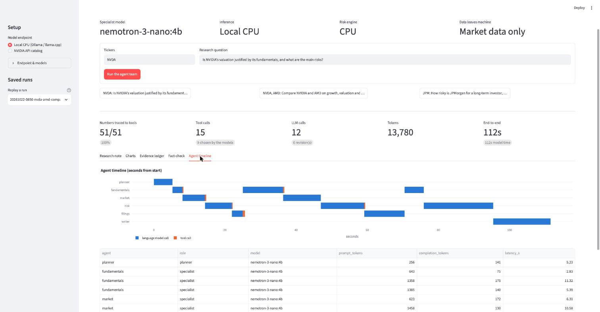
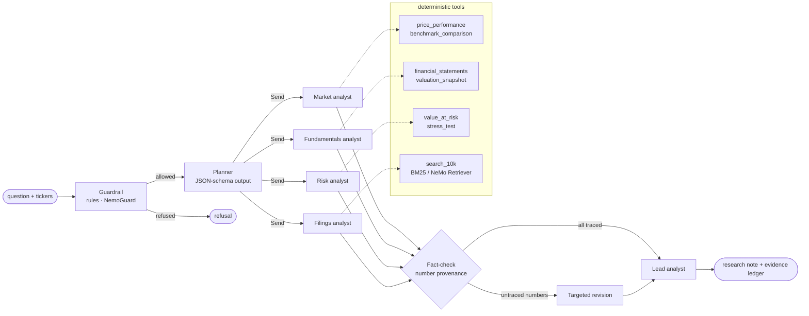

# FinAgent

**Grounded multi-agent equity research on a small NVIDIA Nemotron model — no GPU required.**

FinAgent is a team of AI agents that researches public companies the way an
analyst desk does: a planner assigns work, four specialists (market, fundamentals,
risk, filings) call real data tools in parallel, a fact-checker traces every number
they write back to the tool output it came from, and a lead analyst writes the note.

It is built to make one point measurable: **a 4-billion-parameter model on a CPU
can do useful, auditable agentic work when the system around it is designed for
small models.** The same code moves to NVIDIA NIM endpoints by changing configuration.

## Results — measured, no GPU anywhere

| Machine | Inference server | Question | End to end | Model calls | Tool calls (chosen by the model) | Numbers traced to a tool |
|---|---|---|---|---|---|---|
| Apple M1 Pro laptop, CPU only (`-ngl 0`, 6 threads) | llama.cpp | NVDA: is the valuation justified, what are the risks? | **104 s** | 10 | 9 (9) | 38 / 38 |
| Apple M1 Pro laptop, CPU only | llama.cpp | NVDA vs AMD: growth, valuation, downside risk | **112 s** | 12 | 15 (9) | 51 / 51 |
| Intel Xeon E5-2690 v4 (2016), 8-vCPU VM, 4 threads, shared with another job | Ollama 0.40 | NVDA: is the valuation justified, what are the risks? | **454 s** | 10 | 9 (9) | 35 / 35 |

Model: [NVIDIA Nemotron 3 Nano 4B](https://huggingface.co/nvidia/NVIDIA-Nemotron-3-Nano-4B-GGUF), Q4_K_M, 2.8 GB.
The notes and full run records (every prompt's token count, every tool call and result)
are in [`examples/`](examples/); the web UI replays them without a model. The risk
engine's million-path Monte Carlo VaR takes 137 ms on the same laptop CPU
(`finagent bench-risk`).

What a run looks like (laptop CPU; each line is a model call or a tool call with its evidence ID):

```
08:49:56  fundamentals   model   7.5s  651→65 tok  → financial_statements, valuation_snapshot
08:49:56  fundamentals   F1  financial_statements(ticker=NVDA, years=3) 0.05s
08:49:56  fundamentals   F2  valuation_snapshot(ticker=NVDA) 0.09s
08:50:04  market         model   8.1s  628→88 tok  → price_performance, benchmark_comparison
08:50:04  market         M1  price_performance(ticker=NVDA, period=5y) 0.03s
08:50:04  market         M2  benchmark_comparison(ticker=NVDA, benchmark=SPY, period=5y) 0.02s
08:50:21  filings        model   6.4s  462→81 tok  → search_10k, search_10k
08:50:22  filings        D1  search_10k(ticker=NVDA, query=competition) 0.32s
08:50:22  filings        D2  search_10k(ticker=NVDA, query=supply constraints) 0.0s
...
08:51:06  fact-check   fundamentals: 8/8 numbers traced
08:51:06  fact-check   market: 7/7 numbers traced
08:51:06  fact-check   risk: 11/11 numbers traced
```




## Why

- **Access.** Most agentic-AI teaching assumes a GPU or a paid API. FinAgent runs on
  a student laptop or a shared university CPU server with
  [NVIDIA Nemotron 3 Nano 4B](https://huggingface.co/nvidia/NVIDIA-Nemotron-3-Nano-4B-GGUF)
  served by Ollama or llama.cpp.
- **Small models are enough for most agent steps.** NVIDIA Research argues that
  small language models are sufficient and far more economical for the narrow,
  repetitive sub-tasks that make up agentic systems
  ([Belcak et al., 2025](https://arxiv.org/abs/2506.02153)). FinAgent is a concrete
  case study with the telemetry to check the claim.
- **Finance needs auditability.** A research note is only useful if its numbers
  are right. Every figure here is traceable to a tool call, a public source and,
  for fundamentals, the exact SEC filing.

## How it works



The workflow is a [LangGraph](https://langchain-ai.github.io/langgraph/) state
machine (`finagent/graph.py`). Specialists fan out with LangGraph's `Send` API;
progress streams to the CLI and web UI as it happens.

| Agent | Tools | Data |
|---|---|---|
| Market analyst | `price_performance`, `benchmark_comparison` | daily prices; SPY benchmark; 13-week T-bill from the US Treasury |
| Fundamentals analyst | `financial_statements`, `valuation_snapshot`, `calculator` | SEC EDGAR XBRL company facts (10-K/10-Q) |
| Risk analyst | `value_at_risk`, `stress_test` | historical + 100,000-path bootstrap Monte Carlo VaR/CVaR; 2018, 2020, 2022 crash windows |
| Filings analyst | `search_10k` | latest 10-K from EDGAR, split into Item 1, 1A, 7 and 7A, retrieved with BM25 (plus NeMo Retriever embeddings on NIM) |

## Design principles for small-model agents

1. **Narrow agents.** Each specialist has two or three tools and a short prompt with
   an exact output template. Narrow scope is what makes a 4B model's tool calls reliable.
2. **Tools compute, models narrate.** The model never does arithmetic. Tools return
   finished numbers in the units an analyst quotes (`total_return_pct: 22.82`,
   `market_cap_bn: 5349.48`); derived figures go through a `calculator` tool so they are traceable too.
3. **Constrain structure, don't request it.** The planner's output is bound to a JSON
   schema, which Ollama and llama.cpp compile into a decoding grammar.
4. **Verify deterministically.** Instead of a large LLM-as-judge, `provenance.py`
   extracts every number from the prose and matches it against the evidence it
   cites, allowing for rounding and unit changes (0.2282 → 22.82%, 215,938,000,000 →
   $215.94B). Agents with untraceable numbers get one targeted revision; anything still
   untraced is flagged ⚠ in the note.
5. **Guarantee coverage.** If a model skips a tool call the answer needs (say, the second
   ticker), the system runs it and records that it did. No finding rests on missing data.
6. **Report honestly.** Every run records which tool calls the models chose and which the
   system added, every model call's latency and tokens, and the provenance score.
7. **One protocol, any hardware.** Ollama, llama.cpp, self-hosted NIM and the NVIDIA API
   catalog all speak the OpenAI-compatible API, so moving from a laptop CPU to NVIDIA
   GPUs is configuration, not code. The Monte Carlo engine takes its array module as a
   parameter: NumPy on CPU, CuPy on an NVIDIA GPU.

## Quickstart

### 1. Local CPU with Ollama (no GPU, no API key)

```bash
ollama pull nemotron-3-nano:4b                 # 2.8 GB

git clone <this repo> && cd finagent
python -m venv .venv && source .venv/bin/activate
pip install -e ".[ui,dev]"
cp .env.example .env                           # set SEC_USER_AGENT to your name + email

finagent doctor                                # checks endpoint, tool calling, JSON output, data sources
finagent analyze NVDA -q "Is NVIDIA's valuation justified by its fundamentals, and what are the main risks?"
streamlit run app/streamlit_app.py             # web UI with live agent trace, charts, evidence ledger
```

Runs are saved to `reports/` as a Markdown note plus a JSON run record. The web UI can
replay any saved run without calling a model, which helps when presenting a run that
took minutes on a CPU.

### 2. llama.cpp instead of Ollama

```bash
scripts/serve_llamacpp.sh                      # CPU only (-ngl 0), port 8191
FINAGENT_BASE_URL=http://127.0.0.1:8191/v1 finagent doctor
```

### 3. NVIDIA API catalog (NIM)

```bash
export NVIDIA_API_KEY=nvapi-...                # free key from build.nvidia.com
finagent analyze NVDA AMD -q "Compare growth and downside risk" --profile nim
```

The `nim` profile routes specialists to `nvidia/nemotron-3.5-lightning-30b-a3b`, the
planner and writer to `nvidia/nemotron-3-super-120b-a12b`, adds NeMo Retriever
embeddings (`nvidia/nemotron-3-embed-1b`) to the 10-K search, enables the NemoGuard
topic-control rail and runs the specialists in parallel. Point `FINAGENT_BASE_URL` at a
self-hosted NIM container to keep everything on-premises.

### Shared servers behind a proxy

If the Ollama service on a shared machine cannot reach the internet and you cannot
change it, `scripts/ollama_import_gguf.sh` downloads NVIDIA's official GGUF through your
own shell and registers it with Ollama, using the built-in Nemotron renderer and
tool-call parser and a thread cap for polite sharing.

## What small models got wrong, and the fixes

Building this with a 4B model surfaced failure modes that larger models mostly hide.
Each one is now handled by the system rather than by hoping the model behaves, and
each has a regression test.

| Failure seen in real runs | Fix |
|---|---|
| With the answer format in the system prompt, agents skipped their tools and wrote a fluent answer with invented numbers and invented evidence IDs. | **Phase-separated prompting:** the system prompt only says "you have no data until you call your tools"; the format arrives after the first tool results. An answer written with no data is discarded and the agent is nudged once. |
| An agent copied the example bullet from its prompt (a real-looking figure) into its findings. | Prompts use placeholders (`<fact copied from a tool result>`), never sample numbers. Each agent is fact-checked only against **its own** evidence, so borrowing another agent's figure is caught. |
| Correct numbers with wrong labels: an older year's growth quoted as the latest, a 25-day VaR called "1-year". | Tools return **pre-labelled facts**, latest first (`NVDA FY ending 2026-01-25: revenue $215.94bn, up 65.47% year on year`). The model sees only these, which also cut its prompt tokens. |
| Agents stopped after one tool call, or merged two tickers into one portfolio when asked to compare them. | Agents are told which tools they have not used yet; a **coverage check** runs any required call the model still skipped, and the trace records that the system, not the model, made it. |
| The fact-checker flagged "S&P 500" as an untraced figure, and an early version accepted a fabricated number within 0.6% of a real one. | Index and form names are masked; matching allows display rounding only, not "close enough". |

## Repository layout

```
finagent/
  config.py          profiles (local / nim) and FINAGENT_* overrides
  llm.py             OpenAI-compatible client: reasoning toggle, tool-call recovery, JSON schema
  graph.py           LangGraph workflow and event streaming
  agents/            planner, specialists (tool loop + coverage check + revision), writer, guardrails
  tools/             market, fundamentals, risk, filings, calculator
  data/              cached HTTP, SEC EDGAR (XBRL facts, 10-K text), prices, Treasury rate
  analytics.py       returns, drawdowns, beta, historical and Monte Carlo VaR, stress tests
  retrieval.py       chunking, BM25, optional dense embeddings with reciprocal rank fusion
  provenance.py      number extraction and tracing
  report.py          note assembly: key-figures table and evidence ledger come from tools, not models
  cli.py             analyze · doctor · bench-risk · tools
app/streamlit_app.py web UI
tests/               offline test suite (synthetic data + scripted model)
examples/            real run records and notes from the CPU runs in the results table
workshop/LAB.md      two-hour hands-on lab
scripts/             llama.cpp server, offline Ollama import
docs/                screenshots
```

## Testing

```bash
pytest -q
```

The suite runs offline against synthetic prices, synthetic SEC facts and a scripted
model. It covers the finance maths, XBRL parsing (fiscal years, TTM, restatements,
tag changes, share classes), tool-call recovery from text, the provenance checker, the
guardrails, and the full workflow, including a planted hallucination that must be caught
and repaired.

## Teaching with FinAgent

`workshop/LAB.md` is a two-hour lab in the style of an NVIDIA Deep Learning Institute
workshop: six modules, exercises, and an assessment rubric. It needs no GPU. It is
designed as a follow-on to the DLI courses
[*Building Agentic AI Applications with LLMs*](https://learn.nvidia.com/courses/course-detail?course_id=course-v1%3ADLI+C-FX-25+V1)
(LangGraph, tool-using ReAct agents) and *Building RAG Agents with LLMs* (retrieval).

## Limitations

- Daily prices come from Yahoo Finance's public chart endpoint, which is unofficial and
  may change. SEC EDGAR and the US Treasury are official sources.
- XBRL tagging varies by filer. Banks report no gross margin; companies that report
  shares in custom units (for example Berkshire Hathaway) get no valuation rather than
  a guessed one.
- A 4B model writes plainer prose than a frontier model, and the planner sometimes
  picks the whole team when a subset would do. The verification and coverage layers
  keep the *numbers* trustworthy either way; they do not make the *judgement* expert.
- The `nim` profile (NVIDIA API catalog) is implemented and falls back gracefully when an
  endpoint rejects an optional parameter, but the measured results above are all CPU runs;
  run `finagent doctor --profile nim` with your key to check it on your account.
- The note is educational analysis, not investment advice.

## License

MIT for the code. Nemotron models are covered by the
[NVIDIA Open Model License](https://www.nvidia.com/en-us/agreements/enterprise-software/nvidia-nemotron-open-model-license/).
