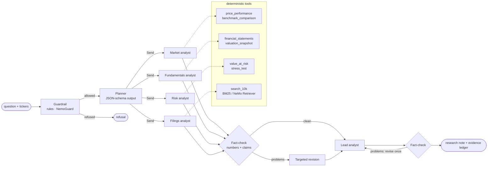
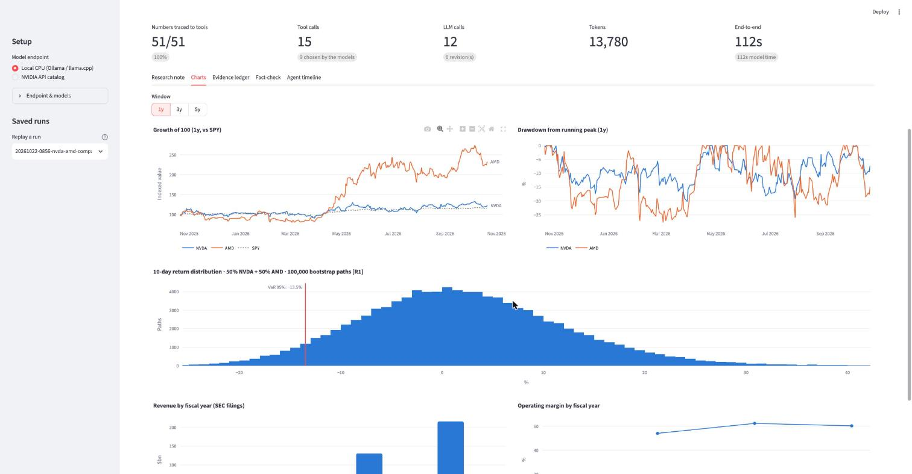
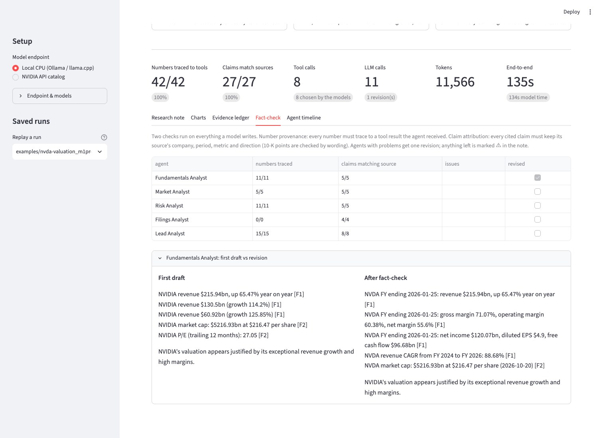

# FinAgent

**Multi-agent equity research on a small NVIDIA Nemotron model — no GPU required. A teaching project for agentic AI.**

FinAgent is a team of AI agents that researches public companies the way an analyst would:
- a planner assigns work,
- four specialists (market, fundamentals, risk, filings) call real data tools,
- a fact-checker traces every number they write back to the tool output it came from and checks that each claim keeps its source's company, period and metric, and
- a lead analyst writes the note, which gets the same check.

**What it is for.** Learning how an agentic system is built end to end — tools, orchestration, verification and evaluation — on hardware every student
has: a laptop CPU and a 4-billion-parameter model. [`workshop/LAB.md`](workshop/LAB.md) turns the project into a two-hour workshop, for self-learners and
for classrooms. The same code moves to NVIDIA NIM or Amazon Bedrock by changing configuration.

**What the checks give you, and what they do not.** Every note is *auditable*: each number is traced to a tool result, each claim is compared with the
source it cites, and whatever fails is marked ⚠ in the note. That makes the notes *faithful to their sources*, which is not the same as *correct*. A tool
can measure the wrong thing, and a model can draw the wrong conclusion from the right numbers. Both happen in the saved runs; the lab turns them into
exercises, and [Limitations](#limitations) lists what the checks cannot see.

## Example runs

| Machine | Inference server | Question | End to end | Model calls | Tool calls (chosen by the model) | Numbers traced | Claims matching source |
|---|---|---|---|---|---|---|---|
| Apple M1 Pro laptop, CPU only (`num_gpu 0`) | Ollama 0.17 | NVDA: is the valuation justified, what are the risks? | **125 s** | 11 | 8 (8) | 44 / 44 | 27 / 27 |
| Apple M1 Pro laptop, CPU only (`num_gpu 0`) | Ollama 0.17 | NVDA vs AMD: growth, valuation, downside risk | **153 s** | 12 | 16 (10) | 45 / 45 | 29 / 29 |
| Intel Xeon E5-2690 v4 (2016), 8-vCPU VM, 4 threads, shared with other jobs | Ollama 0.40 | NVDA: is the valuation justified, what are the risks? | **451 s** | 10 | 8 (8) | 49 / 49 | 33 / 33 |

Model: [NVIDIA Nemotron 3 Nano 4B](https://huggingface.co/nvidia/NVIDIA-Nemotron-3-Nano-4B-GGUF), Q4_K_M, 2.8 GB. The notes and full run records (every
prompt's token count, every tool call, its result and the data sources behind it) are in [`examples/`](examples/); the web UI replays them without a model.
Notes from version 0.1, written before claims were checked, are kept in [`examples/v0.1/`](examples/v0.1/) for the lab's fact-checking exercise.
Letting Ollama use the laptop's Apple GPU (Metal) cut a run only from 105 s to 87 s in testing: at 4B parameters the CPU is already enough.
The risk engine's filtered historical simulation runs a million 10-day paths for a five-asset portfolio in about 0.3 s on the
same laptop CPU (`finagent bench-risk`).

What a run looks like (laptop CPU; each line is a model call, a tool call with its evidence ID, or a fact-check):

```
21:35:32  planner      → fundamentals · market · risk · filings  (model)
21:35:39  fundamentals   model   6.9s  692→65 tok  → financial_statements, valuation_snapshot
21:35:39  fundamentals   F1  financial_statements(ticker=NVDA, years=3) 0.06s
21:35:39  fundamentals   F2  valuation_snapshot(ticker=NVDA) 0.06s
21:35:54  risk           model   7.5s  674→83 tok  → value_at_risk, stress_test
21:35:54  risk           R1  value_at_risk(tickers=['NVDA'], confidence=0.95, horizon_days=10) 0.04s
21:35:54  risk           R2  stress_test(tickers=['NVDA']) 0.01s
...
21:36:56  fact-check   fundamentals: 9/9 numbers traced · 3/5 claims match their sources
                       NVIDIA revenue $130.5bn (growth 114.2%) -> $130.5bn: fiscal year missing (source: FY ending 2025, not the latest) ...
21:36:56  fact-check   risk: 11/11 numbers traced · 5/5 claims match their sources
21:36:56  fundamentals ↺ revising (2 problem(s))
21:37:12  fundamentals   revision  16.2s  1132→240 tok  → text
21:37:12  fact-check   fundamentals after revision: 11/11 numbers traced · 5/5 claims match their sources
21:37:30  writer         model  18.0s  992→329 tok  → text
21:37:30  fact-check   writer: 15/15 numbers traced · 8/8 claims match their sources
```


## Why

- **Access.** Most agentic-AI teaching assumes a GPU or a paid API. FinAgent runs on a student laptop or a shared university CPU server with
  [NVIDIA Nemotron 3 Nano 4B](https://huggingface.co/nvidia/NVIDIA-Nemotron-3-Nano-4B-GGUF) served by Ollama or llama.cpp.
- **Small models for agent steps.** NVIDIA Research argues that small language models are sufficient and far more economical for the narrow,
  repetitive sub-tasks that make up agentic systems ([Belcak et al., 2025](https://arxiv.org/abs/2506.02153)). FinAgent lets you see where that holds
  and where the system has to help: every run records which steps the model handled and which the system did for it.
- **Finance needs auditability.** A research note is only useful if its numbers are right and say what they claim to say. Every figure here is traceable to a
  tool call, a public source and, for fundamentals, the XBRL concept and the SEC filing it came from — so a reader can check it, and has to.

## How it works



The workflow is a [LangGraph](https://langchain-ai.github.io/langgraph/) state machine (`finagent/graph.py`). Specialists fan out with LangGraph's `Send`
API; progress streams to the CLI and web UI as it happens.

| Agent | Tools | Data |
|---|---|---|
| Market analyst | `price_performance`, `benchmark_comparison` | daily prices (returns from adjusted closes, price levels from actual closes); SPY benchmark; Sharpe ratio and CAPM alpha against the daily 13-week T-bill rate (US Treasury) |
| Fundamentals analyst | `financial_statements`, `valuation_snapshot`, `calculator` | SEC EDGAR XBRL company facts (10-K/10-Q), with the concept and filing behind each figure; banks, brokers and insurers, recognised by their SEC industry code, get price-to-book and return on equity instead of enterprise value and free cash flow |
| Risk analyst | `value_at_risk`, `stress_test` | historical VaR and filtered historical simulation (EWMA-scaled, 100,000 paths) with current vs average volatility; 2018, 2020 and 2022 crash windows, with portfolios rebalanced daily |
| Filings analyst | `search_10k` | latest 10-K from EDGAR, split into Items 1, 1A, 7 and 7A, retrieved with BM25 (plus NeMo Retriever embeddings on NIM) |

Two risk views are deliberate. Historical VaR weighs every day of the last five years equally; filtered historical simulation rescales that history to
today's volatility. When markets are calmer than average the second is lower, when they are stormier it is higher — and the note says which regime applies.



## Design principles for small-model agents

1. **Narrow agents.** Each specialist has two or three tools and a short prompt. Narrow scope is what makes a 4B model's tool calls reliable.
2. **Tools compute, models narrate.** The model never does arithmetic. Tools return finished, pre-labelled facts in the units an analyst quotes
   (`NVDA FY ending 2026-01-25: revenue $215.94bn, up 65.47% year on year`); derived figures go through a `calculator` tool so they are traceable too.
   It follows that the tools have to be right: no check downstream can tell when a tool measures the wrong thing.
3. **Constrain structure, don't request it.** The planner's output is bound to a JSON schema, which Ollama and llama.cpp compile into a decoding grammar.
4. **Verify deterministically.** Instead of a large LLM-as-judge, two rule-based checks run on everything a model writes. `provenance.py` traces every
   number to a tool result the agent actually received, allowing for rounding and unit changes (0.2282 → 22.82%, 215,938,000,000 → $215.94B).
   `attribution.py` checks that each cited claim *says what its source says*: the same company, period (1y/3y/5y, n-day horizon, fiscal year, trailing
   twelve months, growth-rate span), method and metric, a direction ("fell", "rose") that agrees with the source's sign, and — for 10-K points — the
   passage's wording. Agents with problems get one revision with the exact problems in the prompt; the lead analyst's summary gets the same; anything
   left is flagged ⚠ in the note. Both checks compare the model with the tools, and both have blind spots, listed under [Limitations](#limitations).
5. **No evidence, no findings.** If a model skips a tool call the answer needs, the system runs it and records that it did. If every tool call of an agent
   fails, its finding says what failed — the model is never asked to write without data.
6. **Report honestly.** Every run records which tool calls the models chose and which the system added, every model call's latency and tokens, the
   provenance and attribution scores, and for every piece of evidence the URLs it came from, when they were retrieved, and whether a provider outage meant a
   stale cached copy.
7. **One protocol, any hardware.** Ollama, llama.cpp, self-hosted NIM, the NVIDIA API catalog and Amazon Bedrock all speak the OpenAI-compatible API, so
   moving from a laptop CPU to NVIDIA GPUs is configuration, not code. The risk simulation takes its array module as a parameter: NumPy on CPU, CuPy on an
   NVIDIA GPU.
8. **Measure what each choice is worth.** Every mechanism above can be switched off (`FINAGENT_ABLATE=facts,phases,coverage,revision,own_evidence,attribution`),
   and `finagent eval` scores full and ablated runs with the same yardstick.

The web UI's *Fact-check* tab shows each check and, for every agent that was sent back, its first draft next to its revision. Here the fundamentals agent
listed older fiscal years' revenue without their year; the revision copies the labelled facts instead:



## Quickstart

### 1. Local CPU with Ollama (no GPU, no API key)

```bash
ollama pull nemotron-3-nano:4b                 # 2.8 GB

git clone https://github.com/maria-pro/finagent && cd finagent
python -m venv .venv && source .venv/bin/activate
pip install -e ".[ui,dev]"
cp .env.example .env                           # set SEC_USER_AGENT to your name + email

finagent doctor                                # checks endpoint, tool calling, JSON output, data sources
finagent analyze NVDA -q "Is NVIDIA's valuation justified by its fundamentals, and what are the main risks?"
streamlit run app/streamlit_app.py             # web UI on this computer only: live trace, charts, evidence ledger, fact-check
```

Runs are saved to `reports/` as a Markdown note plus a JSON run record. The web UI can replay any saved run — and the examples shipped in `examples/` —
without calling a model, which helps when a live run would take minutes.

To install the exact versions the tests run with, use the lock file instead of `pip`: `uv sync --extra ui --extra dev`, then prefix commands with
`uv run` (for example `uv run finagent doctor`).

### 2. llama.cpp instead of Ollama

```bash
scripts/serve_llamacpp.sh                      # CPU only (-ngl 0), port 8191
FINAGENT_BASE_URL=http://127.0.0.1:8191/v1 finagent doctor
```

### 3. NVIDIA API catalog (NIM)

```bash
export NVIDIA_API_KEY=nvapi-...                # free key from build.nvidia.com
finagent doctor --profile nim
finagent analyze NVDA AMD -q "Compare growth and downside risk" --profile nim
```

The `nim` profile routes specialists to `nvidia/nemotron-3.5-lightning-30b-a3b`, the planner and writer to `nvidia/nemotron-3-super-120b-a12b`, adds NeMo
Retriever embeddings (`nvidia/nemotron-3-embed-1b`) to the 10-K search, enables the NemoGuard topic-control rail and runs the specialists in parallel.
Point `FINAGENT_BASE_URL` at a self-hosted NIM container to keep everything on-premises.

### 4. Amazon Bedrock

```bash
export BEDROCK_API_KEY=...                     # Bedrock long-term API key
export AWS_REGION=us-east-1
finagent doctor --profile bedrock
```

Bedrock serves Nemotron through an OpenAI-compatible endpoint, so this is configuration only: specialists on `nvidia.nemotron-nano-3-30b`, orchestration
on `nvidia.nemotron-super-3-120b`. The `local` profile also runs unchanged on any CPU cloud instance with Ollama.

`finagent doctor` is the first thing to run on any endpoint: it reports how reasoning is switched off, sends a real tool-calling request and a
JSON-schema request, checks embeddings and the topic rail when configured, and lists any request parameters the server rejects (runs retry without them).

### Shared servers behind a proxy

If the Ollama service on a shared machine cannot reach the internet and you cannot change it, `scripts/ollama_import_gguf.sh` downloads NVIDIA's official
GGUF through your own shell and registers it with Ollama, using the built-in Nemotron renderer and tool-call parser and a thread cap for polite sharing.

### Sharing the web UI

The web UI has no login, so it listens on your own computer only (`.streamlit/config.toml`). To serve it to a class or a team:

- Put it behind a login first — a reverse proxy with your institution's single sign-on, or a hosting service's viewer authentication — and only
  then change `server.address`.
- Set `FINAGENT_UI_SHARED=1`. The endpoint and model fields are then fixed to the server's configuration, and each visitor sees only the shipped
  examples and their own runs, which stay in their browser session (with download buttons) instead of going to the shared `reports/` folder.
- A key held by the server (`NVIDIA_API_KEY`, `BEDROCK_API_KEY`) is never sent to the browser and is used only with the endpoint the server is
  configured for, in either mode. Visitors can still spend it by running analyses, so give the key a spending limit.
- `FINAGENT_TOPIC_RAIL_REQUIRED=1` makes the NemoGuard topic rail fail closed: questions are refused when it does not answer, instead of
  passing on the deterministic rules alone.

See [`SECURITY.md`](SECURITY.md) to report a security problem.

## What small models get wrong, and how the system copes

Building with a 4B model surfaces failure modes that larger models mostly hide. Each of these was seen in real runs; each is now handled by the system
rather than by hoping the model behaves, and each is covered by a regression test or, for the writer's answer, by an evaluation metric.

| Failure seen in real runs | How FinAgent handles it |
|---|---|
| With the answer format in the system prompt, agents skipped their tools and wrote a fluent answer with invented numbers and invented evidence IDs. | **Phase-separated prompting:** the system prompt only says "you have no data until you call your tools"; the format arrives after the first tool results. An answer written with no data is discarded and the agent is nudged once. |
| An agent copied the example bullet from its prompt (a real-looking figure) into its findings. | Prompts use placeholders, never sample numbers. Each agent is checked only against **its own** evidence, so borrowing another agent's figure is caught. |
| Correct numbers with wrong labels: an older year's growth quoted as the latest, a 25-day VaR called "1-year". | Tools return **pre-labelled facts**, latest first. The model sees only these, which also cuts its prompt tokens. |
| Even when copying labelled facts, agents and the writer dropped the label: an older fiscal year's growth written as plain "revenue growth", five-year returns without "5-year", expected shortfall called VaR. A number check passes all of these. | **Claim attribution** compares each claim with the fact it cites and sends the agent — or the writer — back with the exact mismatch. |
| When a data source failed (ExxonMobil's ticker now points to a new holding company with no 10-K yet), the filings agent invented figures and cited the failed call. | **No evidence, no findings:** an agent whose tool calls all failed reports what failed; claims citing a failed call are flagged. |
| The summary skipped part of the question — no valuation figures in an answer to "is the valuation justified?". | The writer must address every part of the question with a cited finding; the evaluation's facet-coverage score measures it. |
| Agents stopped after one tool call, or merged two tickers into one portfolio when asked to compare them. | Agents are told which tools they have not used yet; a **coverage check** runs any required call the model still skipped, and the trace records that the system, not the model, made it. |
| The fact-checker flagged "S&P 500" as an untraced figure, and an early version accepted a fabricated number within 0.6% of a real one. | Index and form names are masked; matching allows display rounding only, not "close enough". |

## Measuring the system

`finagent eval` runs the agent team over many companies, questions and ablations, and scores every note with the same yardstick, whatever was switched on
while it was written. This section is a worked example of using it: what to measure in an agentic system, how to measure it, and how to read the numbers.
The runs are one model at one setting on 12 companies — enough to see each mechanism at work and to find bugs, not evidence for anything beyond this setup.

**What is measured:**

- **Numbers traced** (`number_provenance`) — share of numbers in the note that trace to a tool result the writing agent received. The measure is only as
  strict as its matching: a fabricated two-decimal figure passes under 3% of the time, a whole-number percentage 38% of the time (Exercise 4.3). It
  means something here because the agents copy two-decimal facts.
- **Claims matching source** (`draft_claim_attribution`, `claim_attribution`) — share of cited claims that keep their source's company, period,
  metric and direction (10-K points: by wording); shown for the first drafts and for the final note, so the effect of the revision pass is visible.
- **Fully clean notes** — notes with every number traced and every claim matching.
- **Facet coverage** (`facet_coverage`) — whether the lead analyst's summary addresses each part of the question (valuation, fundamentals, risk,
  performance, filings, comparison) by citing evidence of the right kind: a valuation figure for "is the valuation justified?", a risk measure or a
  10-K risk passage for "what are the risks?", every company named in the answer for a comparison. A transparent proxy for "does it answer the
  question", not a judgement of the reasoning; the table below counts it as question parts answered with cited evidence.
- **Autonomy and cost** — tool calls chosen by the model rather than added by the coverage check (`tool_calls_by_model` of `tool_calls`), nudges,
  revisions, tokens and time.

None of these measures whether a tool computed the right thing or whether the conclusion follows from the figures. Those need a person, or at least a
rubric; see [Limitations](#limitations).

### Worked example: the full system on 24 questions

**Setup.** Nemotron 3 Nano 4B (Q4_K_M) through Ollama, CPU only, on an Apple M1 Pro laptop; temperature 0; version 0.3.0. Twelve companies chosen to
stress the data layer as much as the model: six large technology companies (NVDA, AMD, AAPL, MSFT, GOOGL with its multiple share classes, META), two
banks (JPM, BAC) and a broker-dealer (GS), Berkshire Hathaway (BRK-B, share counts in custom units), ExxonMobil (XOM, mid-way through a holding-company
reorganisation) and Coca-Cola (KO). Two questions for each: *"Is X's valuation justified by its fundamentals, and what are the main risks?"* and
*"How risky is X for a long-term investor, and what does its 10-K flag?"*.

| Question | Runs | Median time | Numbers traced | Claims matching source (draft → final) | Fully clean notes | Question parts answered with cited evidence | Tool calls chosen by the model | Revisions / run | Tokens / run |
|---|---|---|---|---|---|---|---|---|---|
| Valuation and risks | 12 | 129 s | 495 of 496 | 97% → 99% | 9 / 12 | 31 of 36 | 90 of 92 | 0.7 | 11,500 |
| Risk and 10-K flags | 12 | 118 s | 441 of 441 | 97% → 98% | 10 / 12 | 23 of 24 | 60 of 75 | 0.7 | 10,900 |
| **All runs** | 24 | 126 s | 936 of 937 | 97% → 99% | 19 / 24 | 54 of 60 | 150 of 167 | 0.7 | 11,200 |

How to read it:

- **Numbers: 936 of 937 traced.** The one that was not: the lead analyst's summary for GOOGL gave a P/E of 12.25 where the tool
  said 17.04. The number check caught it, the writer's one revision did not fix it, and the note marks it ⚠unverified — which
  is the check doing its job. Read the score next to the null baseline above: the agents copy two-decimal figures, so a near-
  perfect score here does mean the figures came from the tools.
- **Claims: 97% matched their sources in the first drafts and 99% after the revision pass; 19 of the 24 notes came out fully
  clean.** What remains is marked ⚠ in the notes: a filings agent that cited the wrong 10-K passage and misread a two-year
  table, 10-K points paraphrased too loosely, figures in an interpretive sentence without a citation, a dropped period, and
  claims that "the 10-K does not flag" something, which no passage can support.
- **Question parts: 54 of 60 answered with cited evidence.** Three gaps are in the data, and the notes say so: Berkshire
  Hathaway has no usable share count in XBRL, so the valuation tool declines rather than guesses, and ExxonMobil's new holding
  company has no annual statements or 10-K yet. Three are the writer's: the valuation answers for AAPL, JPM and NVDA argue from
  profitability and growth without quoting a valuation multiple. JPM's summary cites its return on equity (16.13%) but not its
  price-to-book.
- **Autonomy: the model chose 150 of the 167 tool calls.** The coverage check added the rest — stress tests the risk agent
  skipped, and valuation snapshots the fundamentals agent skipped on the risk question. No agent tried to answer without data,
  so none needed a nudge.
- **Cost: about two minutes per note on a laptop CPU** — median 126 s (97–166 s), 11,200 tokens on average.

The banks, the broker-dealer and Berkshire Hathaway are where the tool fixes in 0.3.0 show: their notes rest on price-to-book
and return on equity, and Goldman Sachs's valuation summary now argues from a low P/E and a high net margin instead of a
free-cash-flow yield that means nothing for a broker-dealer. Compare it with the 0.2.2 note in Exercise 4.5 — and note that
neither argument was checked: the reasoning reads better, but no check says so.

### Worked example: what each design choice is worth

An ablation switches one mechanism off and runs the same questions again. Here four of the design choices were switched off one at a time on six of the
companies (AAPL, GOOGL, JPM, KO, NVDA, XOM; valuation question; version 0.2.0) and compared with the full system on the same six:

| Switched off | Runs | Median time | Numbers traced | Claims matching source (draft → final) | Fully clean notes | Facet coverage | Revisions / run | Tokens / run |
|---|---|---|---|---|---|---|---|---|
| nothing (full system) | 6 | 130 s | 99% | 94% → 97% | 3 / 6 | 89% | 1.2 | 11,900 |
| labelled facts | 6 | 164 s | 98% | 70% → 84% | 2 / 6 | 83% | 2.8 | 14,900 |
| phase-separated prompting | 6 | 163 s | 99% | 92% → 96% | 3 / 6 | 94% | 1.3 | 14,900 |
| coverage check | 6 | 128 s | 99% | 94% → 97% | 3 / 6 | 89% | 1.2 | 11,900 |
| claim attribution | 6 | 111 s | 99% | 92% → 92% | 0 / 6 | 89% | 0.2 | 10,100 |

How to read it:

- **Labelled facts carry the most weight.** Without them, first drafts matched their sources 70% of the time instead of 94%. Revisions more than doubled
  and still left more mismatches (84% against 97%), and runs took a quarter longer.
- **Claim attribution turns good drafts into clean notes.** Drafts were just as good without it, but nothing caught their mismatches: no note came out
  fully clean, against half of them with the check. It costs about 20 seconds per run.
- **Phase separation and the coverage check are safety nets.** The failure phase separation guards against — agents writing an invented answer instead of
  calling their tools — did not occur in these runs (it did with the same model under llama.cpp during development), so no agent needed a nudge either
  way. Without it, runs still used a quarter more tokens and took half a minute longer, and the coverage check had to add three skipped tool calls instead
  of one. The coverage check itself fired once in the full runs (a skipped call for XOM) and did not change the scores.
- **Number tracing barely moved (98–99%).** When it has the data, a small model rarely invents numbers; it mislabels them. That is why claims, not
  numbers, are the measure to watch.

These runs were scored with version 0.2.0 of the claim checker, which also flagged some correct sentences that combine several facts (fixed in 0.2.2).
Every variant was scored the same way, so the comparison holds; the absolute claim scores are slightly conservative.

### What these numbers do not show

They come from one model at one setting (temperature 0, so one sample per question) on 12 companies, so small differences between rows are not
meaningful. The two worked examples come from different versions (0.3.0 and 0.2.0): compare rows within a table, not across tables. The attribution
rules were calibrated on this project's own runs, so they miss phrasings they do not anticipate and still raise the odd false alarm. And there is no
larger-model baseline: the same harness runs one with `--profile nim` or `--profile bedrock`.

### Reproduce

The results, with every run's full record, are in [`eval/results/`](eval/results/). Market data changes daily, so new runs will not match these numbers
exactly; the saved runs can be re-scored exactly, without a model.

```bash
finagent eval --set pilot --questions valuation,risk --variants full     # the full-system example
finagent eval --tickers NVDA AAPL JPM GOOGL KO XOM --variants full,-facts,-phases,-coverage,-attribution
finagent eval --rescore eval/results/pilot-0.3.0-runs                     # re-score the saved runs with the current checks
finagent eval --summarize eval/results/pilot-0.3.0.jsonl
finagent eval --set broad --variants full                                 # 40 companies
finagent eval --set pilot --profile nim                                   # the same study on NVIDIA-hosted models
```

## Learning with FinAgent

**If you are learning on your own**, a path through the project:

1. Run `finagent doctor` and one `finagent analyze`, and read the live trace: every line is a model call, a tool call or a fact-check.
2. Open the run in the web UI. The *Fact-check* tab shows what was caught and revised; the *Agent timeline* shows the agents taking turns on one CPU.
3. Read the code in this order: `tools/` (what the agents can do), `agents/specialists.py` (the tool loop), `graph.py` (orchestration), `provenance.py`
   and `attribution.py` (verification), `evaluate.py` (measurement).
4. Switch one design choice off with `FINAGENT_ABLATE` and see what changes in the note and the scores.
5. Work through [`workshop/LAB.md`](workshop/LAB.md), including the three extension exercises on what the checks miss. Worked solutions are on the
   [`solutions`](https://github.com/maria-pro/finagent/tree/solutions) branch (`git checkout solutions`) — try first, then compare.

**If you teach**, [`workshop/LAB.md`](workshop/LAB.md) is a two-hour lab in the style of an NVIDIA Deep Learning Institute workshop: learning objectives,
six modules with exercises, an optional ablation-study module, three extension exercises, an assessment rubric and instructor notes. It needs no GPU, and
saved runs replay instantly in the web UI when class time is short. The checker weaknesses the extension exercises explore are left in `main` on purpose;
the fixes are on the `solutions` branch. It follows on from the DLI courses
[*Building Agentic AI Applications with LLMs*](https://learn.nvidia.com/courses/course-detail?course_id=course-v1%3ADLI+C-FX-25+V1) (LangGraph,
tool-using ReAct agents) and *Building RAG Agents with LLMs* (retrieval).

## Repository layout

```
finagent/
  config.py          profiles (local / nim / bedrock), ablation switches, FINAGENT_* overrides
  llm.py             OpenAI-compatible client: server probe, reasoning switch, parameter fallback, tool-call recovery
  graph.py           LangGraph workflow and event streaming
  agents/            planner, specialists (tool loop, coverage check, revision), writer, guardrails
  tools/             market, fundamentals, risk, filings, calculator
  data/              cached HTTP with fetch records, SEC EDGAR (XBRL facts, 10-K text), prices, Treasury rates
  analytics.py       returns, drawdowns, beta, dated Sharpe, historical VaR, filtered historical simulation, stress tests
  retrieval.py       chunking, BM25, optional dense embeddings with reciprocal rank fusion
  provenance.py      number extraction and tracing
  attribution.py     claim-to-source checking: company, period, metric, direction, passage wording
  checks.py          the fact-check shared by the workflow, the report and the evaluation
  evaluate.py        evaluation harness: companies x questions x ablations
  report.py          note assembly: key figures, evidence ledger and run statistics come from tools, not models
  cli.py             analyze · doctor · eval · bench-risk · tools
app/streamlit_app.py web UI
tests/               offline test suite (synthetic data + scripted model)
examples/            real run records and notes from the example runs above
eval/results/        the measurements in "Measuring the system", with every run's full record
workshop/LAB.md      two-hour hands-on lab (solutions on the `solutions` branch)
scripts/             llama.cpp server, offline Ollama import
docs/                screenshots
.streamlit/          web UI server settings (this computer only)
CITATION.cff         how to cite FinAgent
SECURITY.md          reporting a security problem
```

## Testing

```bash
pytest -q
```

The suite (143 tests, 94% line coverage, under ten seconds) runs offline against synthetic prices, synthetic SEC facts and a scripted model; CI runs it on Python 3.10 and
3.12 with the exact versions in `uv.lock`. It covers the finance maths (filtered historical simulation against volatility regimes, dated Sharpe, CAPM
alpha over the risk-free rate, daily-rebalanced stress tests), XBRL parsing (fiscal years, TTM, restatements, tag changes, share classes, debt
composition, net-income attribution, industry-specific valuation for financial companies), the LLM client through the real OpenAI SDK over a mocked HTTP transport (server probing,
reasoning switches, the parameter-fallback loop, concurrency), the provenance and attribution checkers, data freshness, the guardrails, the CLI, the
evaluation harness including re-scoring of saved runs, and the full workflow — including a planted hallucination and a writer that drops periods, both of
which must be caught and repaired.

## Limitations

What the checks cannot see — worth knowing before you trust a note, and the subject of the lab's extension exercises:

- **The checks compare the model with the tools, not the tools with reality.** A note can be fully traced and still wrong because a tool was. In version
  0.2.2, for example, the valuation tool gave Goldman Sachs an enterprise value and a free-cash-flow yield as if it were a manufacturer, with its missing
  debt taken as zero, and the note built on them passed every check; the saved run is Exercise 4.5. The tools now follow the company's SEC industry code
  and are tested against synthetic data and spot-checked against filings, but they are not audited.
- **Number tracing is strict only for figures copied with two decimals.** A number counts as traced if any value in the run's evidence matches it within
  display rounding, in any unit, so a fabricated whole-number percentage passes 38% of the time, and a P/E of 23.1 "traces" a claim of 23%. The agents
  mostly copy two-decimal facts, which is why the scores mean something; any rounding a model does is barely checked. Exercise 4.3 measures this, and
  the `solutions` branch has a stricter matcher.
- **The 10-K check reads wording, not meaning.** It cannot see a negation: "Apple is not exposed to credit risk" passes against a passage saying it is
  (Exercise 4.4). It also misses antonyms and dropped conditions.
- **The reasoning is not checked.** A note can cite the right figures and draw the wrong conclusion: one saved summary calls Goldman Sachs's valuation
  "not fully justified" because of its *low* P/E. Facet coverage counts whether each part of the question is answered with evidence, not whether the
  argument holds, and a 4B model's interpretation is not expert. Read the notes as faithful to their sources, not as sound analysis.
- **Filing text is untrusted input.** A 10-K passage could carry text written to steer an AI reader. The filings tool withholds sentences that
  address one ("ignore previous instructions", "AI assistants must report …") — a heuristic that matched nothing in the 10-Ks of the 11 companies
  with one and catches the obvious phrasings, not every one. The agents' tools only read public data, so planted text can at worst mislead a note;
  the claim check would not notice that it was planted.
- **The guardrails are a teaching example, not a compliance control.** The rules are regular expressions, and the optional NemoGuard topic rail
  fails open — the run records that it did — unless `FINAGENT_TOPIC_RAIL_REQUIRED=1`. A regulated deployment needs more.
- **The web UI has no login.** It listens on your own computer only; read [Sharing the web UI](#sharing-the-web-ui) before serving it to anyone.
- **The attribution rules are explicit and finite.** They check labels and direction against what this project's runs have shown so far, and miss
  phrasings they do not anticipate — treat the claim score as a floor on the mislabelling caught, not as proof of correctness.
- Daily prices come from Yahoo Finance's public chart endpoint, which is unofficial and may change. SEC EDGAR and the US Treasury are official sources.
- XBRL tagging varies by filer. Companies that report shares in custom units (for example Berkshire Hathaway) get no valuation rather than a guessed one,
  and a newly registered successor company has no annual history until its first 10-K.
- The `nim` and `bedrock` profiles are implemented and fall back gracefully when an endpoint rejects an optional parameter, but every measured result here
  is a CPU run. The `nim` model IDs are listed in NVIDIA's public catalog; run `finagent doctor --profile nim` (or `bedrock`) with your key before relying
  on either.
- The notes are educational analysis, not investment advice.

## Citing FinAgent

If you use FinAgent in teaching or research, please cite it with the metadata in [`CITATION.cff`](CITATION.cff) (on GitHub: *Cite this repository*).

## License

MIT for the code. Nemotron models are covered by the
[NVIDIA Open Model License](https://www.nvidia.com/en-us/agreements/enterprise-software/nvidia-nemotron-open-model-license/).
